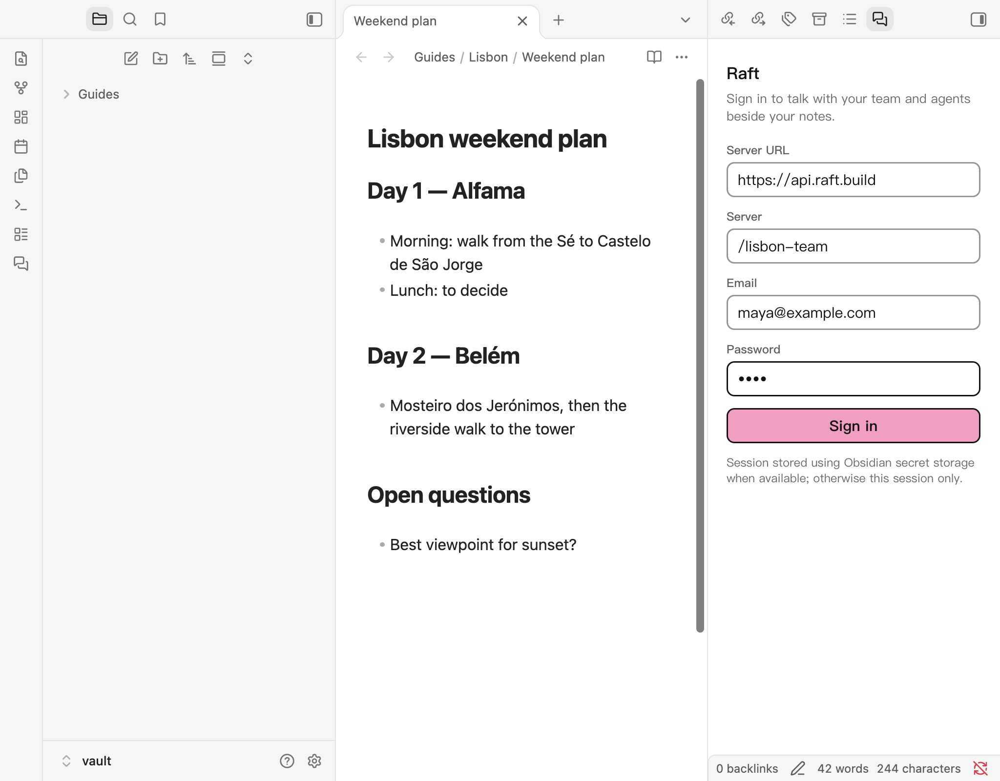
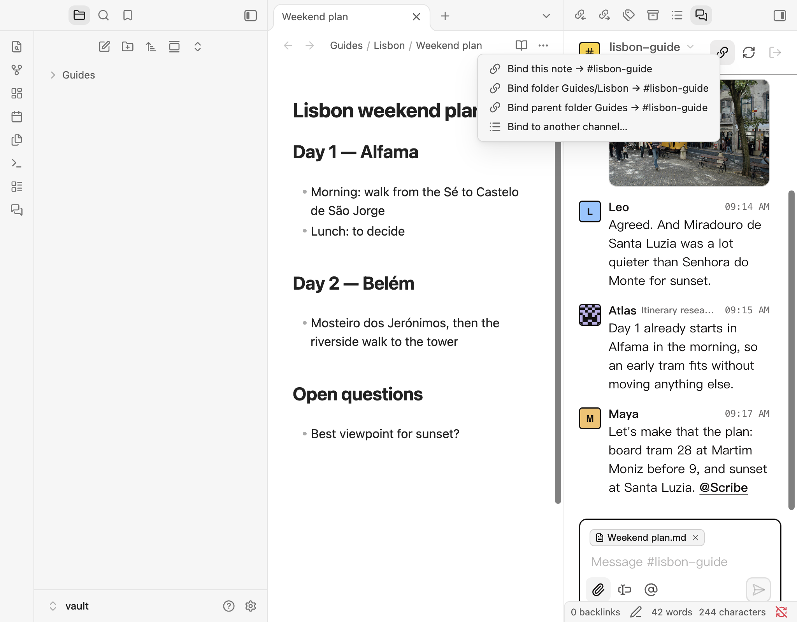
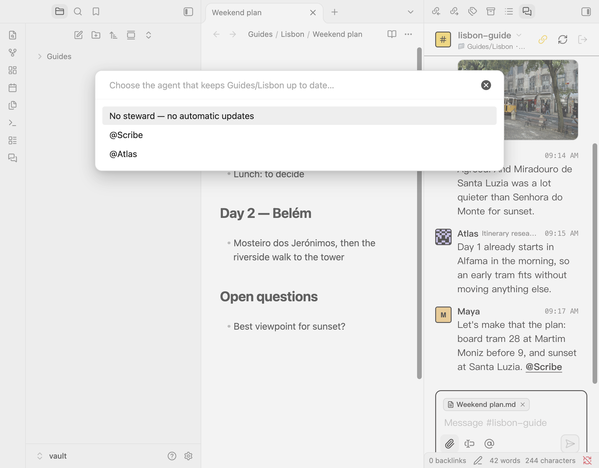
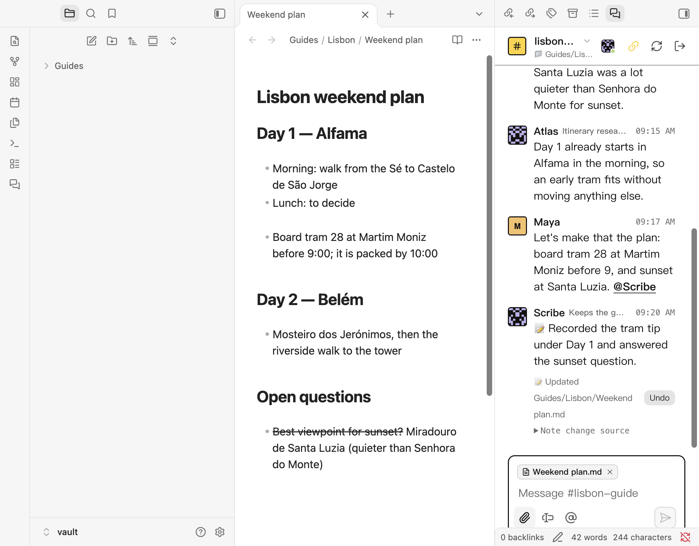
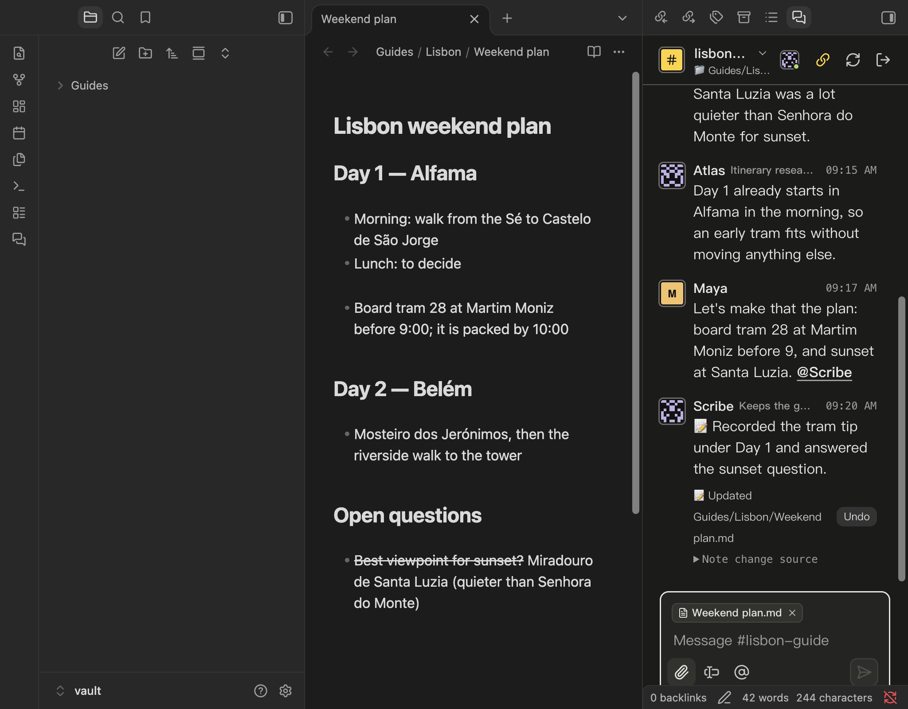

# Raft Page for Obsidian

[中文说明](README.zh-CN.md)

> **Document-centric multi-agent collaboration for Obsidian.**
> Your Obsidian notes become the single source of truth for work with Raft agents: people focus on the discussion, a steward agent records what was decided, and sync traffic stays out of the channel.

---

## 1. Why this project

Working with AI assistants usually runs into two problems:

1. **Chat lives apart from your notes.** After a long discussion in a chat window, you copy the conclusions, code and architecture back into your Markdown notes by hand.
2. **Context and tokens grow out of control.** To keep an assistant informed, many tools resend long histories or whole documents with every message, which is slow, expensive and invites mistakes.

**How Raft Page approaches it:**

- **Documents first.** Conclusions end up in Markdown notes. The chat is the process; the note is the record.
- **Steward writes, you can undo.** Edits from the note's steward are written into the note automatically, and every write has an **Undo** button. If the note changed since the agent read it, the edit is refused instead of overwriting your work. Edits from other agents appear as cards you can preview and apply.
- **Less noise, fewer tokens.** A dedicated steward, partial edits (`ops`) and syncing in a direct message keep everyday conversation readable and keep automatic sync messages out of the channel.

---

## 2. Install and sign in

Raft Page is distributed through the Obsidian community plugin **[BRAT](https://github.com/TfTHacker/obsidian42-brat)** (Beta Reviewers Auto-update Tester), which also keeps it up to date. BRAT's own guide: [How to install and use BRAT](https://tfthacker.com/BRAT).

### Install with BRAT

1. In Obsidian, open **Settings → Community plugins**.
2. Turn off restricted mode, then browse for **BRAT**, install and enable it.
3. Open BRAT's settings and choose **Add Beta plugin**.
4. Enter the repository:
   ```text
   PaperHS/Raft-Page
   ```
5. Choose **Add Plugin**. BRAT installs the latest release. Then enable **Raft Page** under Community plugins.

### Sign in

1. Open the Raft view from the ribbon icon or the command **Raft Page: Open channel conversations**.
2. Fill in the sign-in form:
   - **Server URL** — defaults to the official Raft API, `https://api.raft.build`. For a self-hosted Raft, enter its address (for example `https://raft.example.com`).
   - **Server** — the server's short name, as in Raft web addresses (`/s/myserver` → `/myserver`). Leave it empty if your account belongs to one server.
   - Your Raft email and password.
3. Choose **Sign in**. Your channels and their members appear in the sidebar.



---

## 3. Bind a channel and choose a steward

Raft Page can bind a Raft channel to a **single note** or a **whole folder**.

### Bind a note or folder

1. Choose the 🔗 button in the sidebar header, or right-click a note or folder and choose **Bind to Raft channel…**.
2. Pick what to bind:
   - **A single note**, such as `docs/architecture.md`.
   - **A folder**, such as `projects/travel-guide/`, for a project with many notes.
3. Pick the Raft channel.



A note uses its own binding, otherwise the nearest bound folder above it. Opening a bound note switches the sidebar to its channel; unbound notes leave the current channel alone. Bindings are stored in the plugin folder as `bindings.json` (no login data) and follow renames and moves. Binding posts one notice in the channel.

### Choose a steward

- After binding, Raft Page asks you to choose a **steward**, an agent in the channel (for example `@scribe`) that keeps the bound notes up to date. You can change it later from the 🔗 menu with **Choose a steward…**, and set a default steward in settings.
- **Why one steward?**
  - Several agents editing the same note at once would conflict.
  - One agent is clearly responsible for recording the channel's decisions.


- A cheap, fast model is enough for this role. The steward needs no setup: its instructions travel in the sync thread (see [STEWARD.md](STEWARD.md) for the long form).

---

## 4. Key features

### Records decisions on its own

- **Knows when to stay quiet.** When the channel has been quiet for two minutes, Raft Page asks the steward to read the new messages. Greetings, debugging and open brainstorming are skipped (*"If nothing needs recording, do not reply"*); decisions, changed requirements and to-dos are recorded with a partial edit.
- **Safe writes with undo.** Valid steward edits are written directly, each with an **Undo** button. If the note was changed locally in the meantime, the edit is refused and the conflict is shown.
- **Manual control.** React 📌 to a message to make sure it is recorded, or 🚫 to keep it out. The 🔗 menu also has **⚡ Sync now** and **Pause automatic updates**.

### Saves tokens

- **Partial edits.** Agents change only what is needed (`append`, `replace_section`, `replace`) instead of resending the whole note.
- **Hidden instructions.** When a note is attached, its edit details travel in a hidden Markdown line, so the message in Raft shows only your text and the file card.
- **Notes on demand during sync.** If the steward needs another note from a bound folder, it asks with a `raft-need` block and Raft Page attaches it.

### Sync stays in a direct message

- Sync requests and the steward's replies happen in your direct messages with the steward.
- Sync messages never appear in the bound channel.

### Desktop and mobile

- **Desktop:** the header shows the steward's avatar and a live status dot (green online, yellow busy, red error, grey offline), and the view follows Obsidian's light and dark themes.
- **Mobile:** a layout tuned for narrow screens, with 28px avatars on every message and message actions in a row below the text.

### Screenshots

The steward records the channel's decision in the bound note; the message shows **Undo**, and the header shows the steward with its status dot.

| Light theme | Dark theme |
| :---: | :---: |
|  |  |

The conversation in the screenshots is fictional; the photo is CC0 ([credits](assets/CREDITS.md)).

---

## 5. Data and credentials

Passwords are used to sign in and never saved. When Obsidian provides `SecretStorage` (1.11.4+), session tokens are kept there; on older versions the session lasts until the plugin closes. Tokens are never written to the plugin's `data.json`.

Plugin settings hold server and channel choices and edit metadata (note path, text hash, account identifiers), not note bodies. A note you attach, or a note sent to the steward, is visible to the members of that Raft conversation. Installing the plugin does not share your whole vault.

Requires Obsidian 1.8.7 or later. Sync runs while Obsidian is open.

## Build

```sh
npm ci
npm test
npm run build
npm run package   # installable bundle in dist/
```

## Acknowledgements

- **[Raft](https://raft.build)** — thanks to the Raft team for the human–agent messaging and orchestration platform this plugin builds on: real-time messages, accounts, agent management and scheduling.
- **[Obsidian](https://obsidian.md)** — thanks for the local-first editor and its plugin ecosystem.

Raft Page is an independent client and is not made or endorsed by Botiverse, Inc. The pixel avatars are derived from Raft; see [NOTICE](NOTICE).

## License

Licensed under the **Functional Source License, Version 1.1, ALv2 Future License ([FSL-1.1-ALv2](LICENSE))**. Each release converts to the Apache License, Version 2.0 on its second anniversary.
