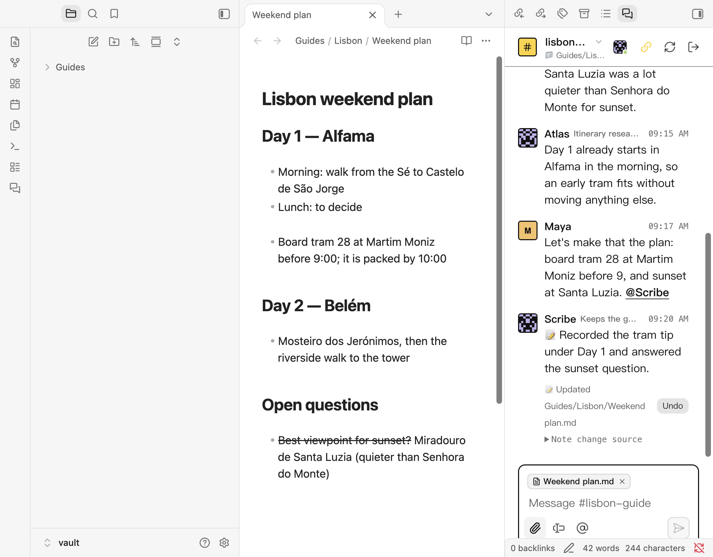
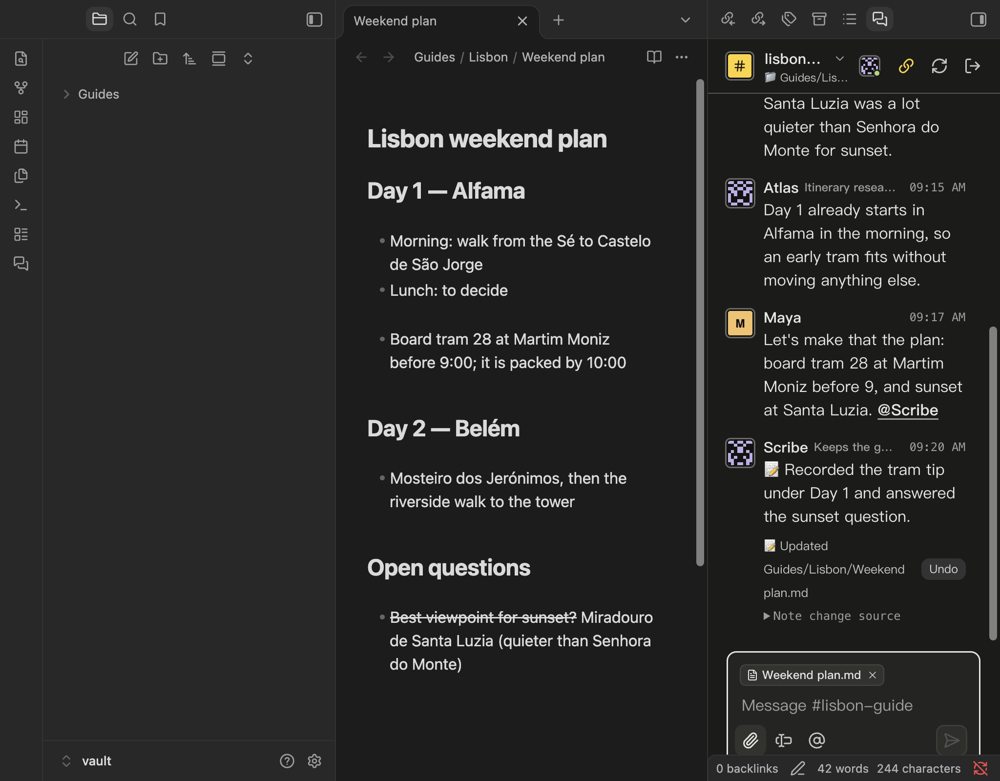
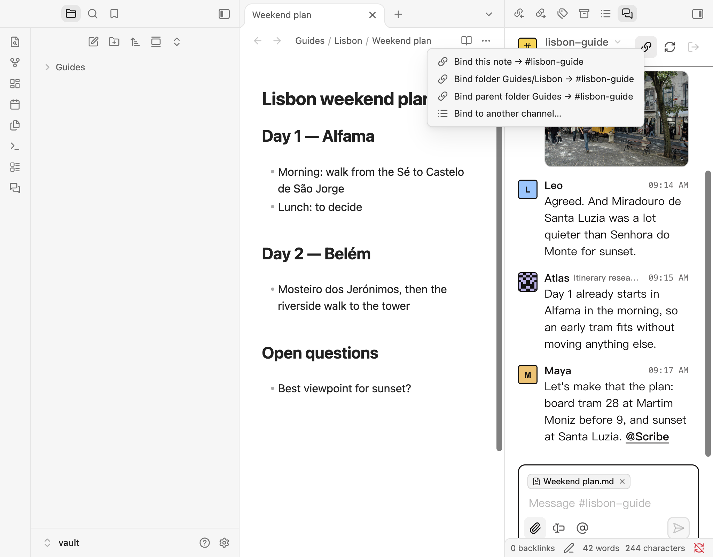
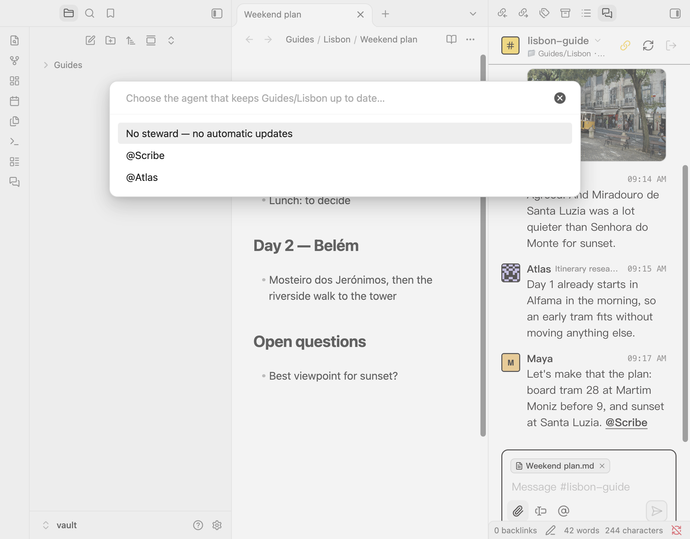
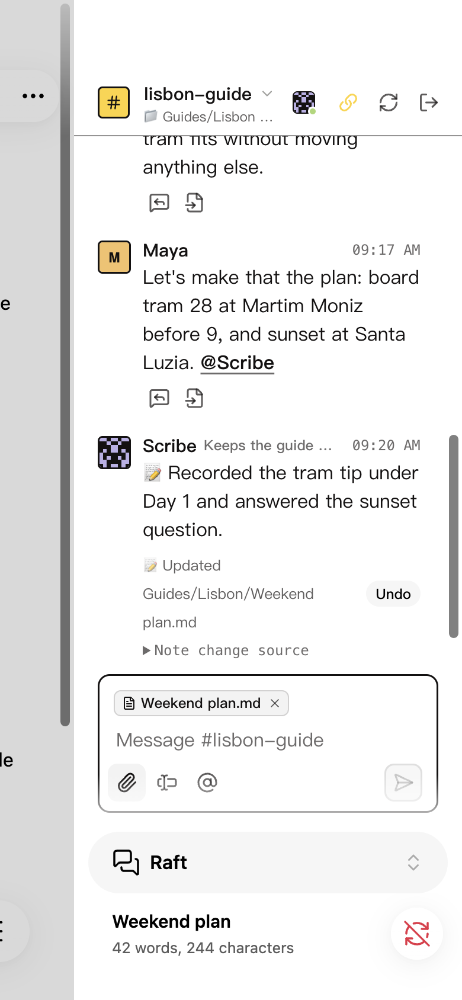

# Raft Page for Obsidian

[English](README.md)

> **Document-Centric Multi-Agent Collaboration for Obsidian.**  
> 让 Obsidian 笔记成为多 Agent 协作的核心事实来源（Single Source of Truth），人专注讨论，管家（Steward Agent）自动提炼沉淀，同步消息不进主频道，按需协作。

---

## 1. 为什么做这个项目？（Background & Introduction）

在传统的大模型或 AI 助手使用中，我们常常陷入两种困境：
1. **割裂的聊天窗口**：在网页端或独立聊天窗口里聊完一段长篇大论，得手动把结论、代码和技术架构复制粘贴回本地 Markdown 知识库；
2. **失控的上下文与 Token 膨胀**：为了让 AI 理解项目，很多系统每次发消息都塞入海量历史或整篇文档，既缓慢昂贵，又极易产生模型幻觉。

**Raft Page 的核心设计**：
- **以文档为中心（Document-Centric）**：讨论的结论沉淀到 Markdown 笔记中，聊天只是过程，文档才是唯一事实来源；
- **管家写入与即时撤销**：指定管家（Steward）的有效修改自动写入本地笔记，且每次写入后界面都提供 Undo 撤销按钮；检测到版本冲突时拒绝覆盖，保护本地数据；普通 Agent 的修改提案依然支持卡片预览后手动应用；
- **降噪与 Token 优化**：通过“专属文档管家”、“局部修改指令（`ops`）”以及“私聊隔离同步”，让日常沟通回归纯粹，自动化同步消息不进主频道。

---

## 2. 快速安装与登录（Quick Installation）

本项目目前通过 Obsidian 社区广受欢迎的 **[BRAT](https://github.com/TfTHacker/obsidian42-brat)（Beta Reviewers Auto-update Tester）** 插件进行分发与自动更新。 BRAT 官方安装与使用说明：[How to install and use BRAT](https://tfthacker.com/BRAT)。

### 第一步：安装并配置 BRAT
1. 打开 Obsidian **设置（Settings）➔ 第三方插件（Community plugins）**；
2. 关闭安全模式，点击浏览并搜索安装 **BRAT**，安装后启用；
3. 打开 BRAT 设置页，点击 **Add Beta plugin**；
4. 在弹出窗口中填入 GitHub 仓库地址：
   ```text
   PaperHS/Raft-Page
   ```
5. 点击 **Add Plugin**，BRAT 会自动拉取最新 Release 并安装。随后在“第三方插件”列表中启用 **Raft Page**。

### 第二步：登录与连接
1. 打开 Obsidian 右侧边栏，点击 Raft 图标展开 Raft Page 视图；
2. 登录面板包含以下配置项：
   - **Server URL**：默认预置官方接入点 `https://api.raft.build`（自建 Raft 实例请填写自建服务地址，如 `https://raft.example.com`）；
   - **Server**：填写 Server 短名（如 `/myserver`，即 Raft 网址里 `/s/myserver` 部分；若账号只加入了一个 Server 可留空）；
   - 输入你的 Raft 账号与密码；
3. 点击 **Sign in**，登录成功后即可无缝浏览你所在的 Raft 频道与团队成员。

---

## 3. 核心用法：绑定 Channel 与指定文档管家（Bindings & Steward）

Raft Page 允许你将一个 Raft 频道直接与 Obsidian 中的**单篇笔记**或**整个文件夹**深度绑定。

### 1. 绑定单篇文档或文件夹
1. 在侧边栏顶部点击 🔗 **绑定图标**；
2. 选择要绑定的目标：
   - **单文档绑定（Single Note）**：例如绑定 `docs/architecture.md`；
   - **文件夹绑定（Folder Project）**：例如绑定 `projects/travel-guide/`（适合包含数十篇文档的大型项目）；
3. 选择对应的 Raft 频道（Channel）。

### 2. 指定文档管家（Steward Agent）
- 绑定完成后，插件会自动弹出管家选择窗口；你也可以随时在 🔗 菜单中点击 **Choose a steward…** 进行更改；
- 为该文档或项目指定一位专属的 **管家（Steward）**（例如 `@scribe`）；
- **为什么需要专属管家？**
  - 避免频道内多位 Agent 争相修改同一篇笔记造成写入冲突；
  - 责任明确：文档管家如同严谨的速记员与架构师，负责在后台守护讨论共识。

---

## 4. 主要特色能力（Key Features）

### ① 智能识别新事实，自动主动沉淀（Autonomous Sync）
- **懂分寸的管家**：管家 Agent 遵循沉淀准则。当频道里聊的是寒暄、排错或发散脑暴时，管家保持静默（*“If nothing needs recording, do not reply”*）；一旦产生明确共识、决策或待办，管家便会在后台发起局部更新；
- **自动安全写回与一键撤销**：管家发出的有效修改直接自动写入本地文件，插件界面提供即时 Undo 撤回按钮；若文档在本地被修改导致版本不一致，插件拒绝覆盖并提示冲突。

### ② 节省 Token 与减少冗余（Token Optimization）
- **局部修改指令（Ops Patching）**：Agent 更新文档时只改需要的部分（支持 `replace_section`、`append`、`replace` 等局部操作），不重发整篇文档，大幅降低输出 Token 消耗；
- **隐形上下文协议**：附带文档的指令与协议说明采用 Markdown 隐藏引用传递，普通聊天气泡清爽无冗余文字；
- **按需补全（On-demand Pull）**：管家若在同步中发现缺少某篇关联文档，可自主发出 `raft-need` 请求，插件按需补全对应笔记。

### ③ 私聊隔离同步（DM Isolated Sync）
- 后续的自动同步请求与管家确认均隔离在人类与管家的 **1-on-1 私聊（DM）** 中进行；
- 主讨论频道干干净净，同步消息不进主频道。

### ④ 桌面端与移动端双端适配（Mobile & Desktop UI）
- **桌面端**：标题栏实时展示当前文档管家的在线状态小圆点（绿点在线、黄点忙碌、红点报错、灰点离线），沉浸式嵌入侧边栏，与 Obsidian 浅色/深色主题完美融合；
- **移动端**：专为手机窄屏优化的排版，消息头像调整为紧凑的 28px，快捷操作栏精简至消息下方。

### 界面截图展示（Screenshots）

截图界面为英文。管家把频道里的结论写进绑定的笔记，消息下方有 **Undo**，标题栏显示管家和状态小圆点：

| 浅色主题 | 深色主题 |
| :---: | :---: |
|  |  |

绑定笔记或文件夹、选择管家：

| 绑定菜单 | 选择管家 |
| :---: | :---: |
|  |  |

手机端（Obsidian 移动端界面，iPhone 尺寸）：



截图中的人物和对话均为虚构，照片为 CC0（[来源](assets/CREDITS.md)）。

---

## 5. 致谢（Acknowledgments）

本项目底层依托强大的协同基础设施与扩展生态：
- **[Raft](https://raft.build)**：感谢 Raft 团队打造的优秀 Human-AI 协同消息与调度平台。Raft 提供的实时消息、统一身份认证、Agent 进程管理与轻量调度架构，为本地知识库与智能体的融合提供了坚实底座；
- **[Obsidian](https://obsidian.md)**：感谢 Obsidian 优雅且强大的本地优先（Local-First）插件扩展生态。

Raft Page 是独立开发的客户端，并非 Botiverse, Inc. 出品，也未获其背书。像素头像源自 Raft，详见 [NOTICE](NOTICE)。

---

## 数据与凭据

密码只用于登录，不会保存。Obsidian 提供 `SecretStorage`（1.11.4 及以上）时，登录凭据保存在其中；更早的版本只在插件运行期间保留登录。凭据不会写入插件的 `data.json`。你附带的笔记、发给管家的笔记，对该 Raft 对话的成员可见；安装插件不会共享整个 vault。同步只在 Obsidian 打开时运行。

## License

本项目采用 **Functional Source License, Version 1.1, ALv2 Future License（[FSL-1.1-ALv2](LICENSE)）**。每个版本发布满两年后自动转为 Apache License 2.0。
